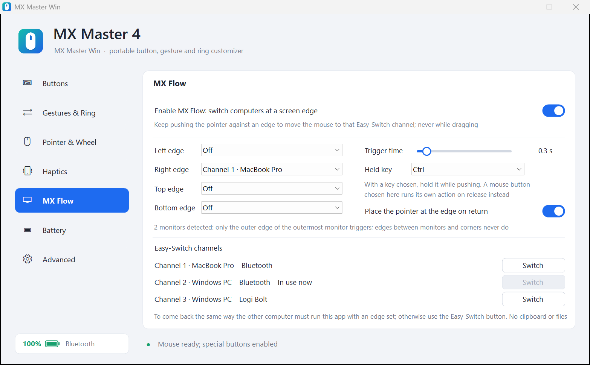
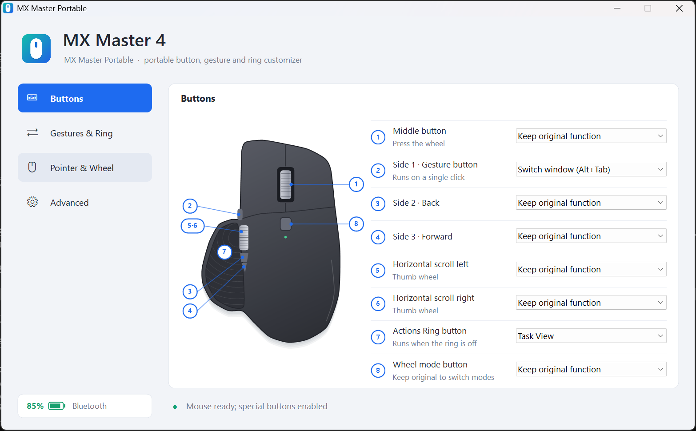
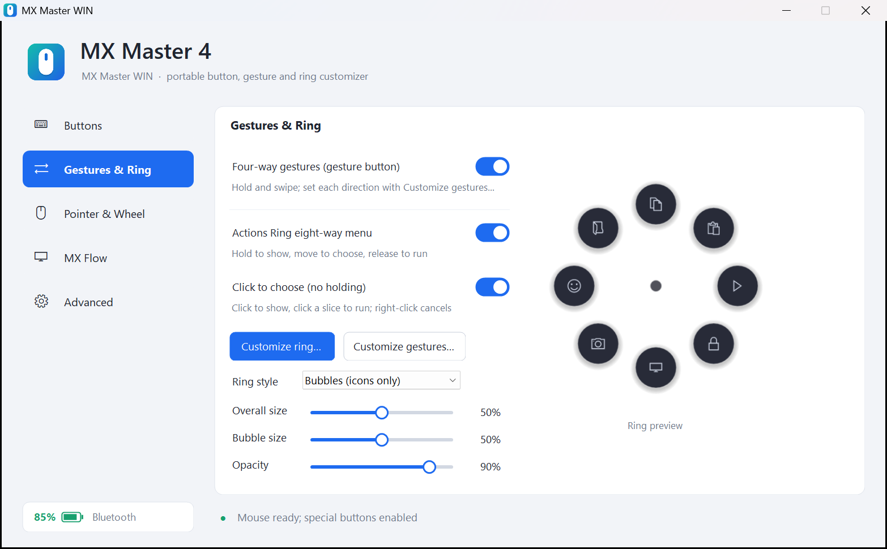
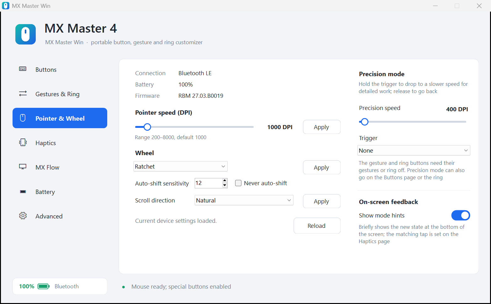

# MX Master Win

<p align="center">
  <a href="README.md">繁體中文</a> · <strong>English</strong>
</p>

<p align="center">
  
</p>

MX Master Win is a portable Windows utility for the Logitech MX Master 4. It is a single EXE that needs no administrator rights and installs no driver or service, yet lets you remap buttons, use thumb gestures and an Actions Ring, and adjust pointer speed, SmartShift, scroll direction and haptic feedback. Version 2.0 adds **MX Flow**: push the pointer against a screen edge and the mouse moves to another computer. It is meant for PCs where Logi Options+ cannot be installed.

It is the Windows edition of the same product as [MX Master Mac](https://github.com/stone5202/MXMasterMac) for macOS, with the same features and the same way of setting them up. Run one edition on each computer and MX Flow takes the mouse back and forth between Windows and Mac.

> Current version: 2.0 · Interface languages: Traditional Chinese, English (follows the system by default)
>
> Up to 1.1 the app was called MX Master Portable. Put the new `MXMasterWin.exe` in the same folder and it picks up the old settings file on first run.

See the [changelog](CHANGELOG.en.md) or [GitHub Releases](https://github.com/stone5202/MXMasterWin/releases) for what changed in each version. The changelog is also available in [Traditional Chinese](CHANGELOG.md).

> This is an independent open-source project. It is not affiliated with, endorsed by or sponsored by Logitech. Logitech, MX Master, Logi Options+ and Logi Bolt are trademarks of Logitech.

## Screenshots

<p align="center">
  
</p>

<p align="center">
  MX Flow
</p>

<p align="center">
  
</p>

<p align="center">
  
  &nbsp;
  
</p>

<p align="center">
  Button mapping · Gestures & ring · Pointer & wheel
</p>

## Download and use

1. Download `MXMasterWin.exe` from [Releases](https://github.com/stone5202/MXMasterWin/releases/latest).
2. Put it in any folder you can write to (settings are stored next to the EXE) and run it.
3. By default the app starts minimized to the system tray. Double-click the tray icon to open settings; use the tray icon menu to exit.

The EXE is not code-signed, so Windows SmartScreen may warn on first launch. On managed PCs with WDAC, AppLocker or Smart App Control, IT approval may be required. This app does not, and should not be used to, bypass those policies.

## Features

- **MX Flow**: keep pushing the pointer against a screen edge and the mouse moves to the Easy-Switch channel you chose (another computer). Each of the four edges can target its own channel, the trigger time is adjustable (0.1–2.0 s), and a held key (Ctrl, Alt, Shift, Win or a button on the mouse) can be required; with several monitors only the outer edge of the outermost monitor triggers. The page also lists the computer name and connection type stored on each of the three channels, with a button to switch directly, and the tray menu has an MX Flow switch.
- **Button mapping**: choose an action for the middle button, gesture button, both side buttons, thumb wheel left and right, the Actions Ring button and the wheel mode button.
- **Built-in actions**: about 50, including back / forward, copy / paste / cut, undo / redo, select all / save / find, Task View, show desktop, switch virtual desktop, Alt+Tab, minimize / maximize / close / snap window, play / pause, previous / next track, volume and mute, File Explorer, Windows Settings, Search, Start menu, Calculator, Task Manager, screenshot, emoji panel, clipboard history, quick settings, lock PC, browser tabs (new / close / reopen / refresh / zoom), type today's date or the current time, Enter, Esc, Delete.
- **Custom actions**: any key combination (for example `Ctrl+Shift+T` or `Win+R`), or launch a program or open a file, folder or URL.
- **Actions Ring**: all eight positions are customizable, and the editor shows a numbered picture of the ring. Use it in hold mode (hold to show, move to choose, release to run) or click mode (press once to show, then left-click, with no holding). There are two looks, Ring and Bubbles, with adjustable overall size, bubble size and opacity.
- **Four-way thumb gestures**: hold the gesture button and swipe; all four directions are customizable.
- **Device settings**: shows battery level and firmware version; adjusts pointer speed (DPI), SmartShift, scroll direction (Standard / Natural) and haptic feedback strength. Values you apply are saved and re-applied at start-up and whenever the mouse reconnects.
- **Recovers after a connection change**: when the mouse goes to another computer and comes back, or moves between Bluetooth and Logi Bolt, the special buttons are enabled again automatically.
- **Connections**: Bluetooth LE and the Logi Bolt receiver.
- **Also**: every setting is saved automatically, only one instance runs, mapping can be paused from the tray, it can start when you sign in to Windows, and the interface switches between Chinese and English.
- **Engineering mode**: view the raw HID events the mouse sends, to identify buttons or report problems.

## Requirements

- Windows 10 or Windows 11
- .NET Framework 4.x (included with Windows; nothing to install)
- Logitech MX Master 4 (Bluetooth LE or Logi Bolt)

## Known limitations

- Developed and tested only on the MX Master 4 (firmware `RBM 27.03`). Other models may only get standard button mapping.
- MX Flow only moves the mouse: no clipboard or files are transferred, and the keyboard does not follow. To come back the same way, the other computer must also run an edition with MX Flow (MX Master Win or MX Master Mac) with an edge set; otherwise press the Easy‑Switch button under the mouse.
- When the mouse reconnects, the app cannot tell where it came back from; with more than one edge set, the pointer is not moved to an edge.
- No per-application profiles or firmware updates.
- The low-level mouse hook cannot tell devices apart: with several mice connected, side-button and horizontal-scroll mappings apply to all of them.
- When Logi Options+ runs at the same time, the two can overwrite each other's button diversion and device settings. Use one or the other.
- Button positions on the diagram are schematic and have not been checked one by one against the hardware.

## How it works

- Standard buttons and horizontal scroll: a Windows low-level mouse hook (`WH_MOUSE_LL`) plus `SendInput` for keyboard actions.
- Special buttons (gesture button `0x00C3`, Actions Ring button `0x01A0`): temporary diversion is set through Windows' built-in HID interface with HID++ 2.0 feature `0x1B04`, and button notifications arrive through Raw Input. Diversion is released when the app is paused or exits.
- Device settings: HID++ features `0x1004` (battery), `0x0003` (firmware), `0x2201` (DPI), `0x2111` (SmartShift), `0x2121` (scroll direction) and `0x19B0` (haptics). Every write is read back to confirm it.
- MX Flow: Raw Input supplies this mouse's own movement, which is used to tell whether the pointer is held against the outer edge of the outermost monitor and still being pushed outward. HID++ feature `0x1814` (change host) sends the switch and `0x1815` reads the host name stored on each channel.
- Reconnect detection: when the mouse sends input again after a pause, the diversion state is read back and re-applied if it is gone; when the current connection stops answering, the app looks for the mouse on the other connections (Bluetooth / Bolt).

HID++ feature numbers and packet layouts follow the public implementations in the open-source projects [Solaar](https://github.com/pwr-Solaar/Solaar) and [logiops](https://github.com/PixlOne/logiops).

## Privacy

- The app makes no network connections and contains no analytics, advertising or tracking. MX Flow only asks the mouse to change channel; the two computers never talk to each other.
- Settings are stored in `mxmaster-win.ini` next to the EXE (a `mxmaster-portable.ini` from 1.1 or earlier is renamed and reused on first run).
- Mouse events are written to `mxmaster-events.log` next to the EXE only while capture is on in engineering mode. The log holds button and HID packets, never keyboard input.
- No driver, service or scheduled task is installed, and the registry is not modified. The app does not start with Windows by default; only when you turn on "Start when I sign in to Windows" on the Advanced page does it put a shortcut in your Startup folder, and it removes it when you turn the switch off.

## Build from source

No Visual Studio or .NET SDK is needed; the C# compiler that ships with the Windows .NET Framework is enough:

```powershell
git clone https://github.com/stone5202/MXMasterWin.git
cd MXMasterWin
powershell -ExecutionPolicy Bypass -File .\build.ps1
```

The output is `build\MXMasterWin.exe`. The whole app is one source file, `src/Program.cs` (C# 5, WinForms), with no external dependencies.

## Project structure

```text
src/
├── Program.cs        # All of the code
├── app.ico           # EXE and window icon
└── app.png           # Logo shown in the interface
tools/
└── make-icon.ps1     # Generates app.ico / app.png
docs/
└── screenshots/      # Screenshots used in the README
build.ps1             # Build script
```

## Contributing

Issues and pull requests are welcome. When reporting a button or device problem, attach the engineering-mode log and mention the connection type (Bluetooth or Bolt) and the mouse firmware version.

Before submitting a change, make sure `build.ps1` builds with no warnings, and keep the app portable, free of administrator rights and free of external dependencies.

## License

This project is licensed under the [MIT License](LICENSE).
