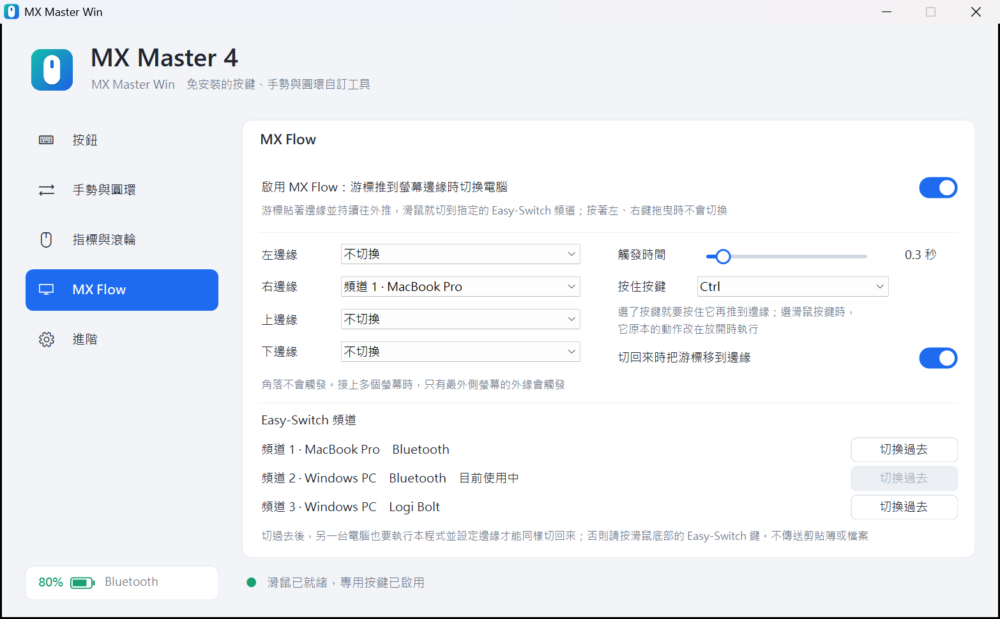
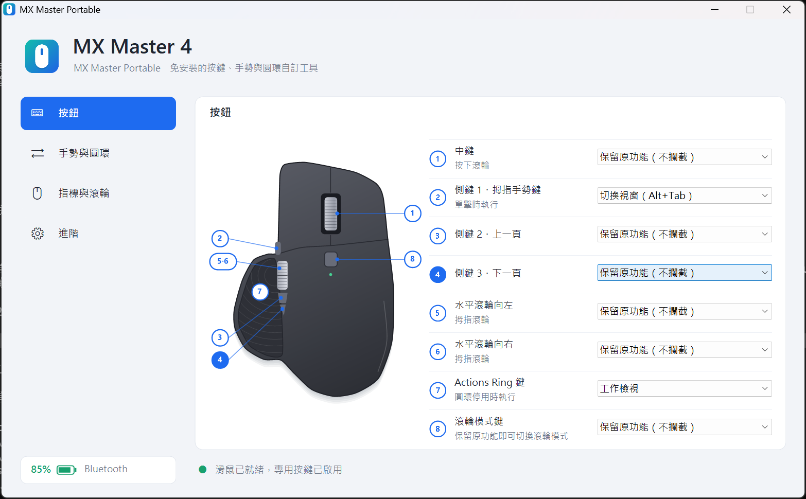
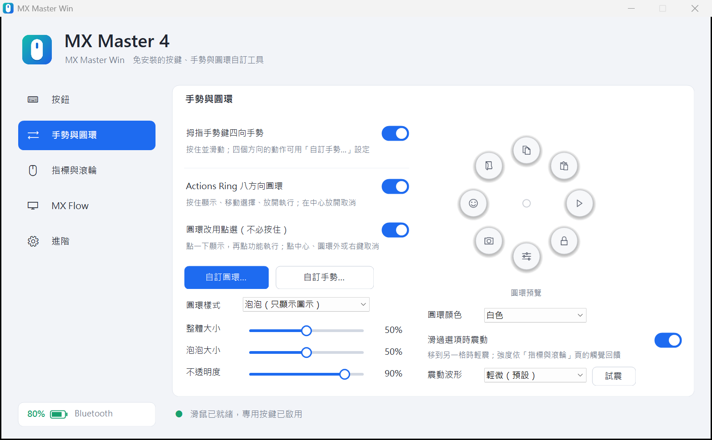
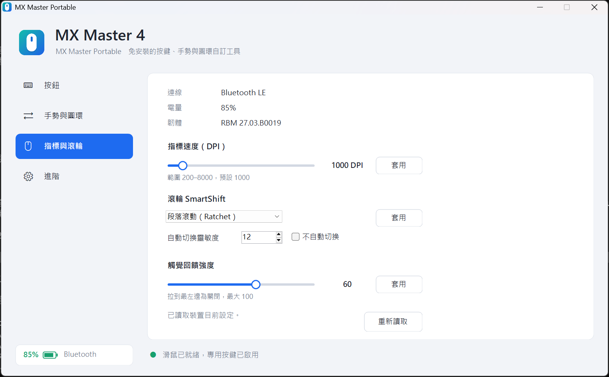

# MX Master Win

<p align="center">
  <strong>繁體中文</strong> · <a href="README.en.md">English</a>
</p>

<p align="center">
  
</p>

MX Master Win 是給 Logitech MX Master 4 用的免安裝 Windows 小工具：單一 EXE、不需要管理員權限、不安裝驅動或服務，就能自訂按鍵、拇指手勢與 Actions Ring 圓環，並調整指標速度、SmartShift、捲動方向與觸覺回饋。2.0 起新增 **MX Flow**：把游標推到螢幕邊緣，滑鼠就切到另一台電腦。適合無法安裝 Logi Options+ 的電腦。

它和 macOS 版 [MX Master Mac](https://github.com/stone5202/MXMasterMac) 是同一個產品的兩個版本，功能與設定方式一致；兩台電腦各裝一個版本，就能用 MX Flow 在 Windows 與 Mac 之間來回切換。

> 目前版本：2.1 · 介面語言：繁體中文、English（預設跟隨系統）
>
> 1.1 以前的名稱是 MX Master Portable。把新的 `MXMasterWin.exe` 放在原本的資料夾，第一次執行時會自動沿用舊的設定檔。

各版本的更新內容請參閱 [更新紀錄](CHANGELOG.md) 或 [GitHub Releases](https://github.com/stone5202/MXMasterWin/releases)。更新紀錄也提供[英文版本](CHANGELOG.en.md)。

> 本專案為個人開源作品，與 Logitech 無任何關係，也未獲其認可或贊助。Logitech、MX Master、Logi Options+、Logi Bolt 為 Logitech 的商標。

## Screenshots

<p align="center">
  
</p>

<p align="center">
  MX Flow
</p>

<p align="center">
  
</p>

<p align="center">
  
  &nbsp;
  
</p>

<p align="center">
  按鈕對應 · 手勢與圓環 · 指標與滾輪
</p>

## 下載與使用

1. 到 [Releases](https://github.com/stone5202/MXMasterWin/releases/latest) 下載 `MXMasterWin.exe`。
2. 放到任何你有寫入權限的資料夾（設定檔會存在 EXE 旁邊），直接執行。
3. 程式預設啟動後直接縮到系統匣；按兩下系統匣圖示開啟設定，要結束請用系統匣圖示的選單。

EXE 沒有數位簽章，第一次執行時 Windows SmartScreen 可能會顯示警告。公司電腦若啟用 WDAC／AppLocker／Smart App Control，可能需要由 IT 核准；本程式不會也不應該用來繞過這些安全政策。

## 功能

- **MX Flow**：游標持續推著螢幕邊緣，滑鼠就切到指定的 Easy-Switch 頻道（另一台電腦）。四個邊緣可分別指定頻道，觸發時間可調（0.1–2.0 秒），可要求按住 Ctrl／Alt／Shift／Win 或滑鼠上的一顆按鍵才切換；多螢幕時只有最外側螢幕的外緣會觸發。也會列出三個頻道記錄的電腦名稱與連線方式，並可直接按鈕切換；系統匣選單裡也有 MX Flow 開關。
- **按鍵對應**：中鍵、拇指手勢鍵、兩個側鍵、拇指滾輪左右、Actions Ring 鍵、滾輪模式鍵，各自選擇動作。
- **內建動作**：約 50 種，包含上一頁／下一頁、複製／貼上／剪下、復原／重做、全選／儲存／尋找、工作檢視、顯示桌面、切換虛擬桌面、Alt+Tab、視窗最小化／最大化／關閉／貼齊左右、播放／暫停、上一首／下一首、音量與靜音、檔案總管、Windows 設定、搜尋、開始功能表、小算盤、工作管理員、螢幕截圖、表情符號、剪貼簿歷程記錄、快速設定、鎖定電腦、瀏覽器分頁（新增／關閉／重開／重新整理／縮放）、輸入今天日期或目前時間、Enter、Esc、Delete，以及開啟本程式設定視窗的「MX設定」。
- **自訂動作**：任意組合鍵（例如 `Ctrl+Shift+T`、`Win+R`），或啟動程式、開啟檔案／資料夾／網址。
- **Actions Ring 圓環**：八個位置都可自訂，設定時有圓環圖片與編號對照。可選按住模式（按住顯示、移動選擇、放開執行）或點選模式（按一下顯示，再用左鍵點選，不必按住）。外觀有「分格圓環」與「泡泡」兩種，可選深色或白色，整體大小、泡泡大小與不透明度可調。游標滑到另一格時滑鼠會輕震一下（可關閉，有 6 種震動波形可選）。
- **拇指四向手勢**：按住手勢鍵並滑動，四個方向的動作都可自訂。
- **裝置設定**：顯示電量與韌體版本；調整指標速度（DPI）、SmartShift、捲動方向（標準／自然）與觸覺回饋強度。套用過的數值會保存，啟動時與滑鼠重新連線後自動再套用。
- **切換連線後自動恢復**：滑鼠切到別台電腦再切回來，或在 Bluetooth 與 Logi Bolt 之間切換，專用按鍵會自動重新啟用。
- **連線方式**：Bluetooth LE 與 Logi Bolt 接收器。
- **其他**：所有設定自動儲存、只會執行一份、可從系統匣暫停、可設定登入 Windows 時自動啟動、介面可切換中文／英文。
- **工程模式**：檢視滑鼠送出的原始 HID 事件，方便辨識按鍵或回報問題。

## 系統需求

- Windows 10 或 Windows 11
- .NET Framework 4.x（Windows 內建，不需另外安裝）
- Logitech MX Master 4（Bluetooth LE 或 Logi Bolt）

## 已知限制

- 只在 MX Master 4（韌體 `RBM 27.03`）上開發與測試；其他型號可能只有標準按鍵對應能用。
- MX Flow 只切換滑鼠：不傳送剪貼簿或檔案，鍵盤不會跟著切換。另一台電腦也要執行有 MX Flow 的版本（MX Master Win 或 MX Master Mac）並設定邊緣，才能用同樣方式切回來；否則請按滑鼠底部的 Easy‑Switch 鍵。
- 滑鼠重新連上這台電腦時分不出是從哪裡切回來的；設定了多個邊緣時，游標不會自動移到邊緣。
- 不包含 Options+ 的逐應用程式設定與韌體更新。
- 低階滑鼠攔截無法分辨來源裝置：同時接多隻滑鼠時，標準側鍵與水平滾輪的對應也會套用到其他滑鼠。
- 與 Logi Options+ 同時執行時，兩者可能互相覆寫按鍵改道與裝置設定，建議擇一使用。
- 示意圖上的按鍵位置為示意，尚未逐一對照實體校正。

## 運作方式

- 標準按鍵與水平滾輪：Windows 低階滑鼠攔截（`WH_MOUSE_LL`）＋ `SendInput` 送出鍵盤動作。
- 專用按鍵（拇指手勢鍵 `0x00C3`、Actions Ring 鍵 `0x01A0`）：透過 Windows 內建 HID 介面，以 HID++ 2.0 的 `0x1B04` 功能設定「暫時改道」，再用 Raw Input 接收按鍵通知。程式暫停或結束時會解除改道。
- 裝置設定：HID++ 功能 `0x1004`（電量）、`0x0003`（韌體）、`0x2201`（DPI）、`0x2111`（SmartShift）、`0x2121`（捲動方向）、`0x19B0`（觸覺回饋）。每次寫入後都會回讀確認。
- MX Flow：以 Raw Input 取得這隻滑鼠的移動量，判斷游標是否貼著最外側螢幕的外緣並持續往外推；以 HID++ 功能 `0x1814`（切換主機）送出切換，`0x1815` 讀取各頻道的主機名稱。
- 重新連線偵測：滑鼠停頓後再有輸入時回讀改道狀態，不符就重新套用；原本的連線沒有回應時，改到其他連線（Bluetooth／Bolt）上找滑鼠。

HID++ 的功能編號與封包格式參考了開源專案 [Solaar](https://github.com/pwr-Solaar/Solaar) 與 [logiops](https://github.com/PixlOne/logiops) 的公開實作。

## 隱私

- 程式不會建立任何網路連線，也不包含分析、廣告或追蹤元件。MX Flow 只是請滑鼠換頻道，兩台電腦之間不會互相連線。
- 設定儲存在 EXE 旁邊的 `mxmaster-win.ini`（1.1 以前的 `mxmaster-portable.ini` 會在第一次執行時自動改名沿用）。
- 只有在工程模式開啟記錄時，才會把滑鼠事件寫入 EXE 旁邊的 `mxmaster-events.log`；記錄內容是按鍵與 HID 封包，不含鍵盤輸入。
- 不安裝驅動、服務或排程工作，也不修改登錄檔。預設不會開機自動啟動；只有你在「進階」頁打開「登入 Windows 時自動啟動」時，才會在你的「啟動」資料夾放一個捷徑，關閉時移除。

## 從原始碼建置

不需要安裝 Visual Studio 或 .NET SDK，使用 Windows 內建的 .NET Framework C# 編譯器即可：

```powershell
git clone https://github.com/stone5202/MXMasterWin.git
cd MXMasterWin
powershell -ExecutionPolicy Bypass -File .\build.ps1
```

輸出為 `build\MXMasterWin.exe`。整個程式是單一原始檔 `src/Program.cs`（C# 5、WinForms），沒有外部相依套件。

## 專案結構

```text
src/
├── Program.cs        # 全部程式碼
├── app.ico           # EXE 與視窗圖示
└── app.png           # 介面內的 logo
tools/
└── make-icon.ps1     # 產生 app.ico／app.png
docs/
└── screenshots/      # README 用的畫面截圖
build.ps1             # 建置腳本
```

## 參與開發

歡迎提交 issue 或 pull request。回報按鍵或裝置相關問題時，請附上工程模式的記錄檔，以及連線方式（Bluetooth 或 Bolt）與滑鼠韌體版本。

送出變更前，請確認 `build.ps1` 能成功建置且沒有警告，並維持免安裝、免管理員權限、無外部相依的原則。

## License

本專案採用 [MIT License](LICENSE)。
